<div align="center">

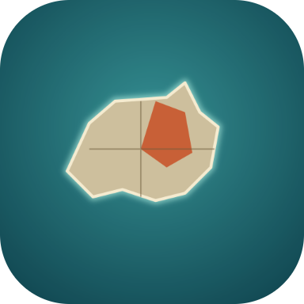

# Australian Battles

**A live multiplayer territory quiz on a map of Australia.**<br>
Join with a code or QR like Kahoot, pick a territory next to yours, answer the question, take the land.

<a href="https://australian-battles.vercel.app"></a>

<br>


<br><br>

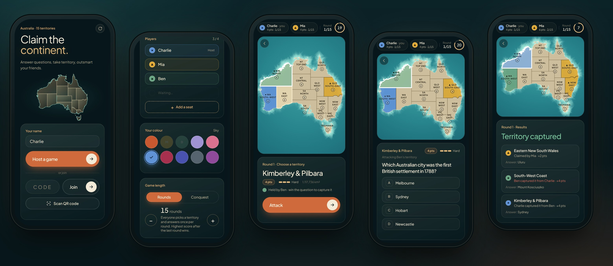

</div>

<br>

<details open>
<summary><strong>🇬🇧 English</strong> (click to fold / unfold)</summary>

<br>

## What is it?

Australia is split into **15 territories**. 2 to 6 players start on opposite sides of the continent. Every round each player picks a territory that touches their own land (free or held by someone else) and answers a quiz question. Win the question, take the territory and its points. Lose land, and you may get to strike back.

It runs in the browser, can be installed on the home screen like an app, and stays in sync live between all devices.

### Highlights

- **Join like Kahoot**: a 5-character room code, an invite link or a QR code. The QR scanner is built in (camera, tap to focus on Android). Tap the lobby QR code to enlarge it for the whole table.
- **2 to 6 players**: 4 seats are always shown, the host can add up to 6 with the plus button.
- **Pick your colour** from 10 presets. A taken colour greys out for everybody the moment it is picked. If two players tap the same colour at the same instant, the server decides: first one wins.
- **Fair, random starts**: every game the start territories are drawn at random and spread as far apart as possible (two players always sit on opposite sides).
- **Points per territory**: 1 (small) to 4 (huge). Bigger territories bring harder questions. Most points wins, most territories breaks ties.
- **Counter-attacks**: attack a held territory and fail, and its owner may strike back in the same round.
- **Game length**: a fixed number of rounds (3 to 30) or *Conquest* until one player owns everything.
- **Leave and come back safely**: a back button with an orange-red warning in the lobby and in the game. The host can end a game for everybody and return to the lobby.
- **Made for every screen**: one column on phones, roomier on tablets upright, two columns on tablets in landscape and on desktop.
- **Snappy**: buttons react instantly (optimistic UI), the server moves the game on the moment the last player has answered.

### Screenshots

<table>
  <tr>
    <td align="center">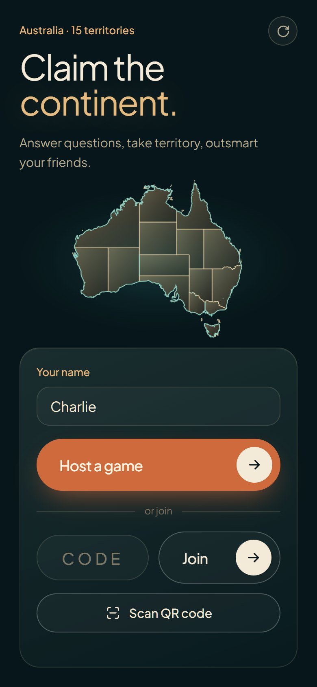<br><sub>Start screen</sub></td>
    <td align="center">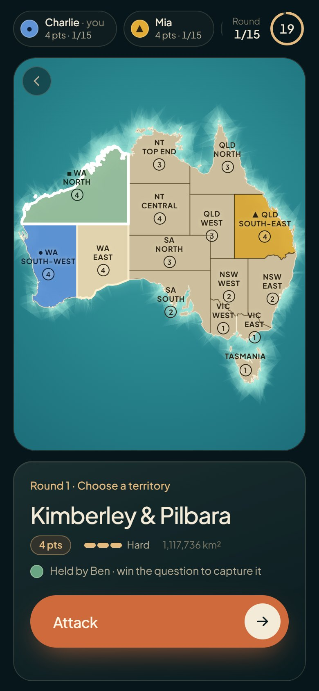<br><sub>Choose a territory</sub></td>
    <td align="center">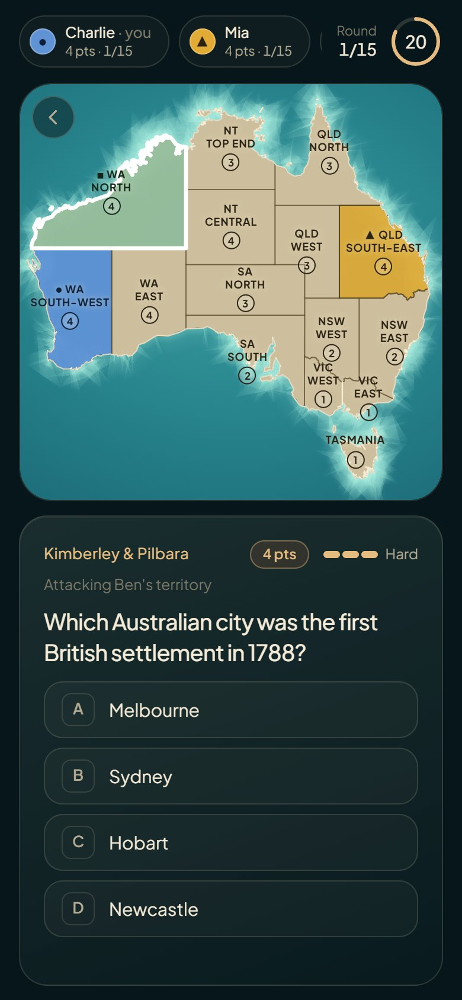<br><sub>Answer the question</sub></td>
    <td align="center">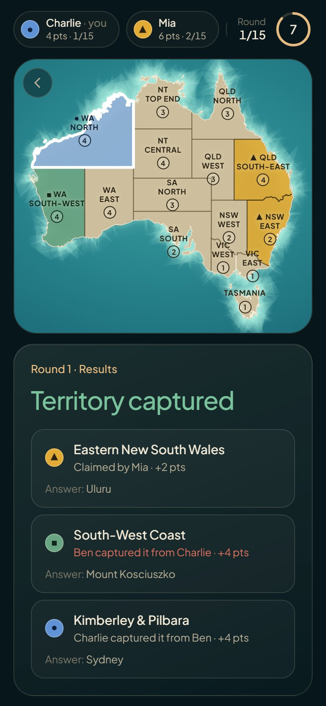<br><sub>Round results</sub></td>
  </tr>
</table>

<table>
  <tr>
    <td align="center">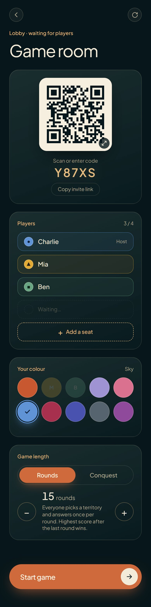<br><sub>Lobby: QR, seats, colours</sub></td>
    <td align="center">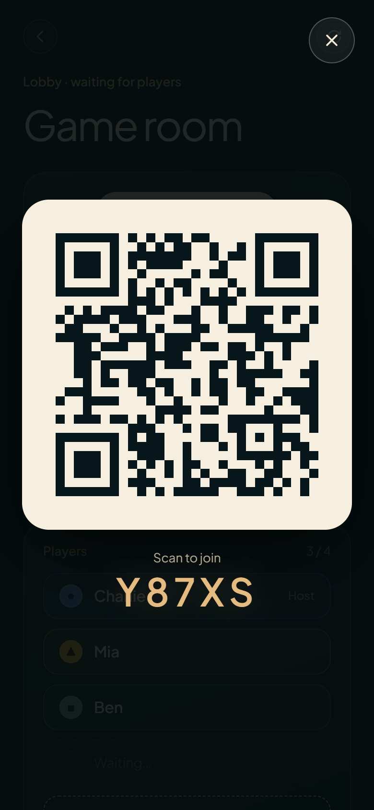<br><sub>Tap the QR code to enlarge it</sub></td>
    <td align="center">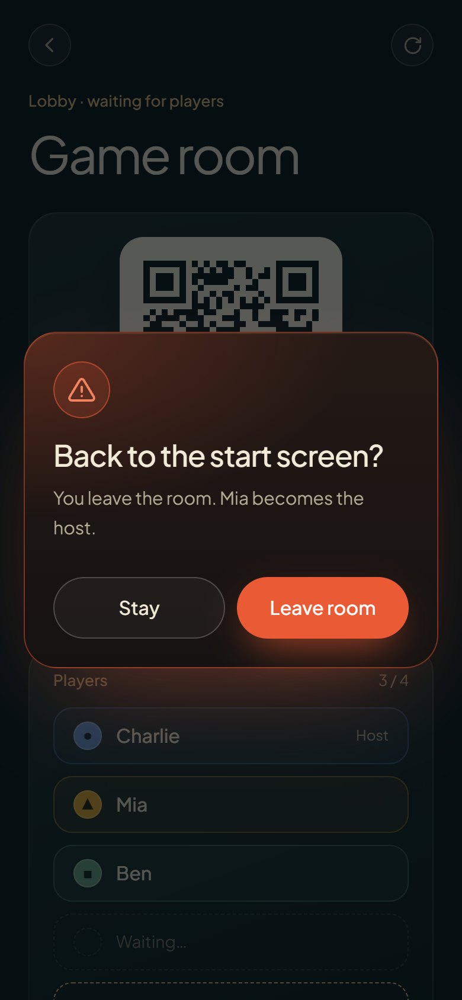<br><sub>Warning before leaving</sub></td>
    <td align="center">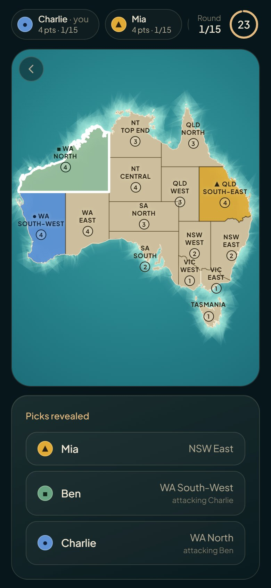<br><sub>Picks revealed</sub></td>
  </tr>
</table>

**Tablet and desktop**

<div align="center">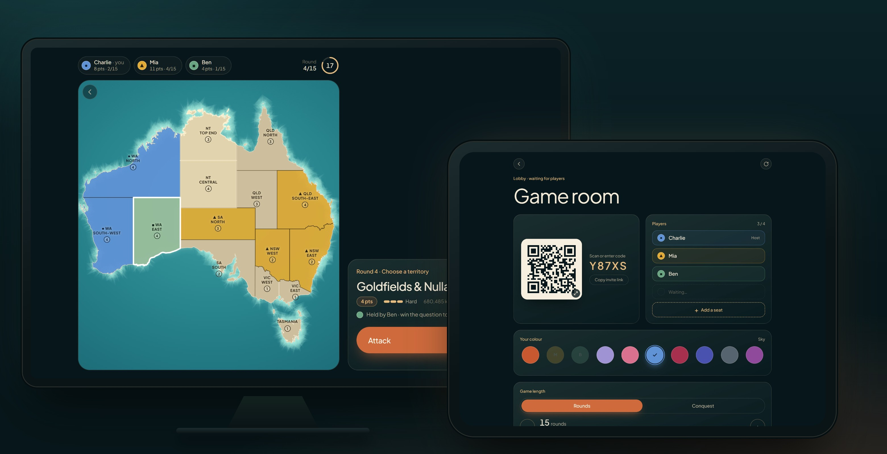</div>

<table>
  <tr>
    <td align="center">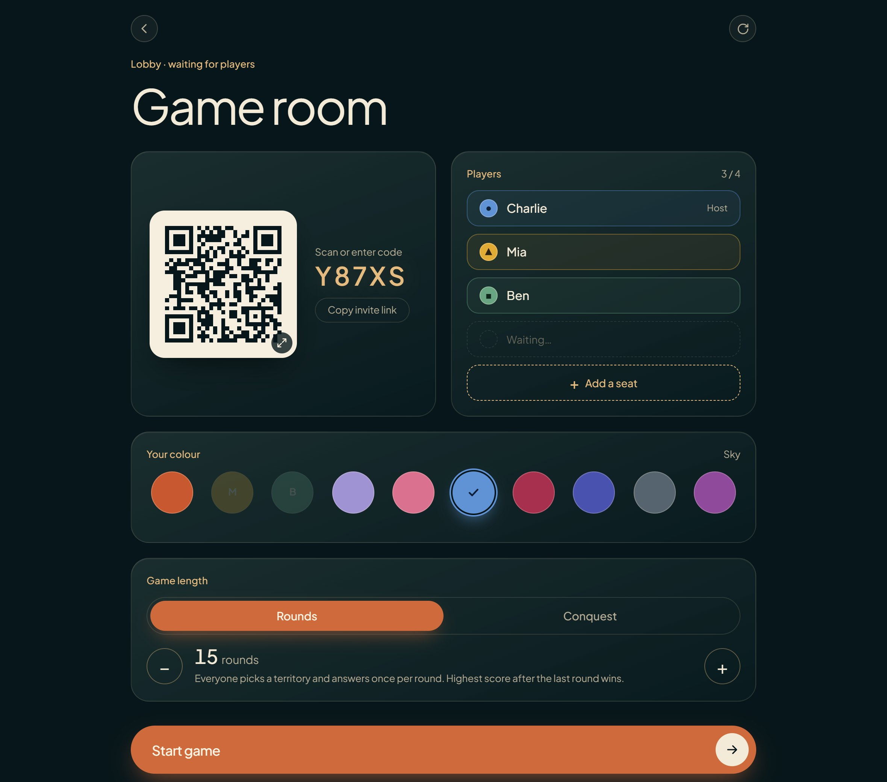<br><sub>Lobby</sub></td>
    <td align="center">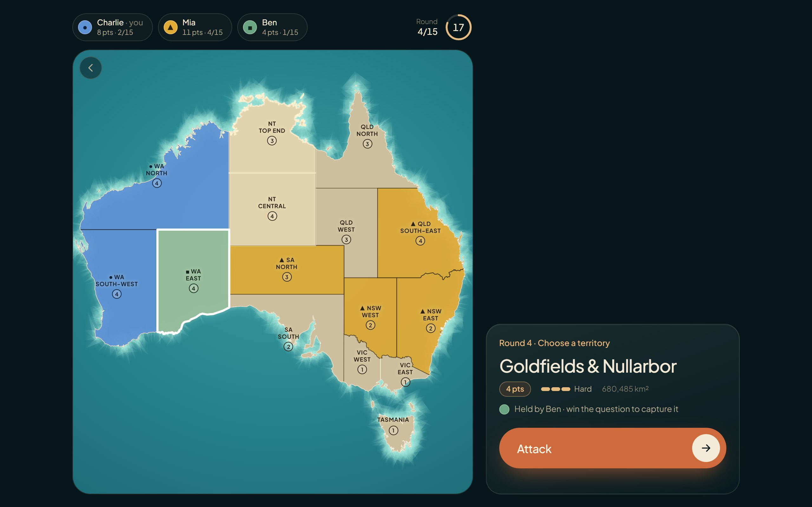<br><sub>Game</sub></td>
  </tr>
  <tr>
    <td align="center" colspan="2">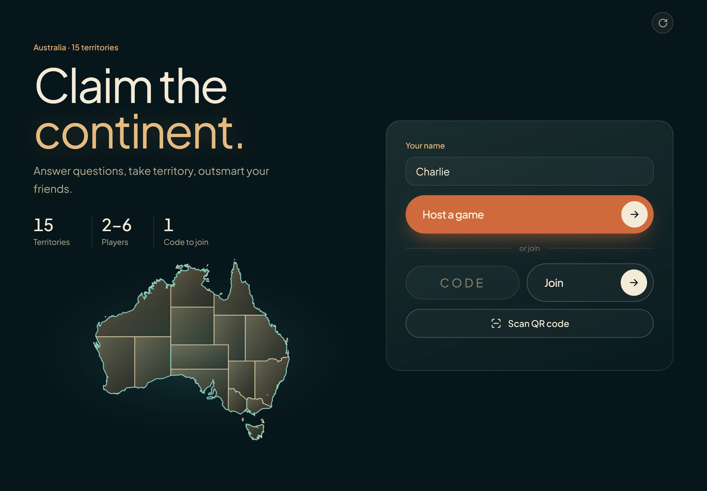<br><sub>Start screen on a tablet in landscape</sub></td>
  </tr>
</table>

### How a game plays

1. The host creates a room and shares the code, link or QR. Players join and pick a colour. The host chooses the game length and starts (at least 2 players).
2. Every player gets a start territory (random, spread out, same value for everybody).
3. **Each round**: pick a territory that touches yours, lock it in. Then all picks are revealed, and everyone answers their question. The fastest correct answer wins if two players picked the same territory (placeholder rule, see below).
4. If you attacked a held territory and failed, the owner gets a **counter-attack** on one of your territories next to theirs.
5. A player who loses their last territory is out and watches. When one player is left, or one player owns everything, the game ends at once.

### Tech stack

| Part | Choice |
| --- | --- |
| App | Next.js 16 (App Router), React 19, TypeScript, Tailwind CSS 4, Motion |
| Map | MapLibre GL with **no external tiles**: sea, land and coast are drawn from the repo's own region data |
| Realtime and data | Firebase Firestore (live snapshots) and anonymous Auth |
| Server logic | One serverless API function (`app/api/[...path]/route.ts`) with `firebase-admin`; every game change runs in a Firestore transaction |
| Hosting | Vercel (functions pinned to Frankfurt, next to the database) |
| Extras | QR codes (`qrcode.react`), QR scanner (native detector or `jsqr`), PWA with service worker |

### Getting started

You need **Node 24**, **Java** (for the Firestore emulator) and nothing else: no Firebase account is required to run it locally.

```bash
npm install
```

Create a file called `.env.local` in the project root:

```bash
NEXT_PUBLIC_USE_EMULATOR=true
NEXT_PUBLIC_FIREBASE_PROJECT_ID=demo-australian-battles
FIREBASE_PROJECT_ID=demo-australian-battles
FIRESTORE_EMULATOR_HOST=127.0.0.1:8080
FIREBASE_AUTH_EMULATOR_HOST=127.0.0.1:9099
```

Then start the emulators and the app together and open <http://localhost:3000>:

```bash
npm run dev:all
```

Open the app in two browser windows (one normal, one private) to play against yourself, or add a test player:

```bash
npm run bot -- ROOMCODE Mia 0.7   # a bot that joins the room and answers right 70 % of the time
```

| Script | What it does |
| --- | --- |
| `npm run dev:all` | Firebase emulators (Auth + Firestore) and the Next.js dev server |
| `npm run bot -- CODE Name 0.7` | Test player for a room |
| `npm run sim` | Scripted 2-player game: attack, failed attack, counter-attack |
| `npm run sim:elim` | Scripted 3-player game: elimination |
| `npm run sim:leave` | Leaving, ending a game, seats, colours (incl. the simultaneous-pick race) |
| `npm run build-regions` | Rebuilds the 15 territories, neighbours and coast from real state outlines |
| `npm run build-hero` | Rebuilds the start-screen map art |

The simulations need fixed start territories, so add `ABT_FIXED_STARTS=1` to your `.env.local` before running `sim` or `sim:elim`. Never set it in production.

### Deploying

1. Create a Firebase project with **Firestore** (choose a region near your players) and enable **anonymous sign-in**. Deploy `firestore.rules` (clients may only read rooms; all writes go through the server).
2. Create a Vercel project from this repo and set the variables from [`.env.example`](.env.example): the four `NEXT_PUBLIC_FIREBASE_*` web-config values and the service account (`FIREBASE_PROJECT_ID`, `FIREBASE_CLIENT_EMAIL`, `FIREBASE_PRIVATE_KEY`). Leave `NEXT_PUBLIC_USE_EMULATOR` unset.
3. In `vercel.json` set the function region next to your database.

Good to know: `package.json` pins `jwks-rsa` to 3.x because the 4.x that `firebase-admin` pulls in crashes on Vercel (`ERR_REQUIRE_ESM`). `firebase init` can overwrite `firestore.rules` with open test rules, always check the file before deploying.

### Project layout

```
app/                 pages (start, join, room) and the single API route
components/          Lobby, game screens, map, QR scanner, dialogs, UI parts
lib/game/            rules, config (colours, regions, timers), questions, types
lib/server/          game engine (all state changes) and Firebase admin
lib/client/          Firebase client, realtime hooks, API helper
data/                region geometry and metadata (generated)
scripts/             region builder, bot, simulations
firestore.rules      clients read rooms, never write, never see answers
```

### Current state

- The **questions are placeholders** (`lib/game/questions.ts`, three difficulty tiers). A real question set is meant to replace them.
- The **clash rule** (two players pick the same territory: fastest correct answer wins) is a placeholder as well.
- There is no license file yet, so by default all rights are reserved. Ask before reusing the code.

</details>

<details>
<summary><strong>🇩🇪 Deutsch</strong> (zum Aufklappen klicken)</summary>

<br>

## Was ist das?

Australien ist in **15 Gebiete** aufgeteilt. 2 bis 6 Spieler starten auf gegenüberliegenden Seiten des Kontinents. In jeder Runde wählt jeder ein Gebiet, das an sein eigenes Land grenzt (frei oder von jemand anderem besetzt), und beantwortet eine Quizfrage. Wer die Frage gewinnt, erobert das Gebiet samt Punkten. Wer Land verliert, darf vielleicht zurückschlagen.

Das Spiel läuft im Browser, lässt sich wie eine App auf den Home-Bildschirm legen und ist live auf allen Geräten synchron.

### Highlights

- **Beitreten wie bei Kahoot**: mit einem 5-stelligen Raumcode, einem Einladungslink oder einem QR-Code. Ein QR-Scanner ist eingebaut (Kamera, auf Android Tippen zum Fokussieren). Ein Tipp auf den QR-Code in der Lobby vergrößert ihn für den ganzen Tisch.
- **2 bis 6 Spieler**: 4 Plätze sind immer sichtbar, der Host kann mit dem Plus-Knopf bis zu 6 öffnen.
- **Eigene Farbe wählen** aus 10 Vorgaben. Eine vergebene Farbe wird bei allen sofort ausgegraut. Tippen zwei Spieler im selben Moment dieselbe Farbe, entscheidet der Server: Wer zuerst da war, bekommt sie.
- **Faire, zufällige Starts**: bei jedem Spiel werden die Startgebiete neu ausgelost und möglichst weit auseinander gelegt (zwei Spieler sitzen immer auf gegenüberliegenden Seiten).
- **Punkte pro Gebiet**: 1 (klein) bis 4 (riesig). Größere Gebiete bringen schwerere Fragen. Wer die meisten Punkte hat, gewinnt, bei Gleichstand zählen die meisten Gebiete.
- **Gegenangriffe**: Wer ein besetztes Gebiet vergeblich angreift, gibt dem Besitzer die Chance, in derselben Runde zurückzuschlagen.
- **Spiellänge**: feste Rundenzahl (3 bis 30) oder *Conquest*, bis einem Spieler alles gehört.
- **Sicher verlassen**: Ein Zurück-Knopf mit orange-roter Warnung in Lobby und Spiel. Der Host kann ein Spiel für alle beenden und zurück in die Lobby gehen.
- **Für jeden Bildschirm gemacht**: eine Spalte auf dem Handy, luftiger auf dem hochkant gehaltenen Tablet, zwei Spalten auf dem Tablet quer und am Desktop.
- **Flink**: Knöpfe reagieren sofort (optimistische Oberfläche), der Server geht weiter, sobald der letzte Spieler geantwortet hat.

### Screenshots

<table>
  <tr>
    <td align="center"><br><sub>Startbildschirm</sub></td>
    <td align="center"><br><sub>Gebiet wählen</sub></td>
    <td align="center"><br><sub>Frage beantworten</sub></td>
    <td align="center"><br><sub>Rundenergebnis</sub></td>
  </tr>
</table>

<table>
  <tr>
    <td align="center"><br><sub>Lobby: QR, Plätze, Farben</sub></td>
    <td align="center"><br><sub>QR-Code antippen zum Vergrößern</sub></td>
    <td align="center"><br><sub>Warnung vor dem Verlassen</sub></td>
    <td align="center"><br><sub>Wahlen aufgedeckt</sub></td>
  </tr>
</table>

**Tablet und Desktop**

<div align="center"></div>

<table>
  <tr>
    <td align="center"><br><sub>Lobby</sub></td>
    <td align="center"><br><sub>Spiel</sub></td>
  </tr>
  <tr>
    <td align="center" colspan="2"><br><sub>Startbildschirm auf dem Tablet quer</sub></td>
  </tr>
</table>

### So läuft ein Spiel

1. Der Host erstellt einen Raum und teilt Code, Link oder QR. Die Spieler treten bei und wählen eine Farbe. Der Host legt die Spiellänge fest und startet (mindestens 2 Spieler).
2. Jeder bekommt ein Startgebiet (zufällig, weit auseinander, für alle gleich viel wert).
3. **Jede Runde**: ein Gebiet wählen, das an dein Land grenzt, und festlegen. Dann werden alle Wahlen aufgedeckt, und jeder beantwortet seine Frage. Haben zwei dasselbe Gebiet gewählt, gewinnt die schnellste richtige Antwort (Platzhalter-Regel, siehe unten).
4. Wer ein besetztes Gebiet vergeblich angegriffen hat, gibt dem Besitzer einen **Gegenangriff** auf eines deiner Gebiete neben seinem Land.
5. Wer sein letztes Gebiet verliert, scheidet aus und schaut zu. Bleibt nur noch einer übrig oder gehört einem alles, endet das Spiel sofort.

### Technik

| Teil | Auswahl |
| --- | --- |
| App | Next.js 16 (App Router), React 19, TypeScript, Tailwind CSS 4, Motion |
| Karte | MapLibre GL **ohne externe Kacheln**: Meer, Land und Küste werden aus den eigenen Gebietsdaten im Repo gezeichnet |
| Echtzeit und Daten | Firebase Firestore (Live-Snapshots) und anonyme Anmeldung |
| Serverlogik | Eine einzige Serverless-API-Funktion (`app/api/[...path]/route.ts`) mit `firebase-admin`; jede Spieländerung läuft in einer Firestore-Transaktion |
| Hosting | Vercel (Funktionen in Frankfurt, direkt neben der Datenbank) |
| Extras | QR-Codes (`qrcode.react`), QR-Scanner (nativer Detektor oder `jsqr`), PWA mit Service Worker |

### Loslegen

Du brauchst **Node 24** und **Java** (für den Firestore-Emulator). Ein Firebase-Konto ist zum lokalen Ausprobieren nicht nötig.

```bash
npm install
```

Lege im Projektordner eine Datei `.env.local` an:

```bash
NEXT_PUBLIC_USE_EMULATOR=true
NEXT_PUBLIC_FIREBASE_PROJECT_ID=demo-australian-battles
FIREBASE_PROJECT_ID=demo-australian-battles
FIRESTORE_EMULATOR_HOST=127.0.0.1:8080
FIREBASE_AUTH_EMULATOR_HOST=127.0.0.1:9099
```

Dann Emulatoren und App zusammen starten und <http://localhost:3000> öffnen:

```bash
npm run dev:all
```

Öffne die App in zwei Browserfenstern (eins normal, eins privat), um gegen dich selbst zu spielen, oder füge einen Testspieler hinzu:

```bash
npm run bot -- RAUMCODE Mia 0.7   # ein Bot, der dem Raum beitritt und zu 70 % richtig antwortet
```

| Skript | Was es tut |
| --- | --- |
| `npm run dev:all` | Firebase-Emulatoren (Auth + Firestore) und der Next.js-Entwicklungsserver |
| `npm run bot -- CODE Name 0.7` | Testspieler für einen Raum |
| `npm run sim` | Skriptgesteuertes 2-Spieler-Spiel: Angriff, gescheiterter Angriff, Gegenangriff |
| `npm run sim:elim` | Skriptgesteuertes 3-Spieler-Spiel: Ausscheiden |
| `npm run sim:leave` | Verlassen, Spiel beenden, Plätze, Farben (inkl. gleichzeitiges Wählen derselben Farbe) |
| `npm run build-regions` | Baut die 15 Gebiete, Nachbarn und Küste aus echten Bundesstaaten-Umrissen neu |
| `npm run build-hero` | Baut die Karten-Grafik des Startbildschirms neu |

Die Simulationen brauchen feste Startgebiete: Trage vor `sim` oder `sim:elim` `ABT_FIXED_STARTS=1` in deine `.env.local` ein. In Produktion niemals setzen.

### Veröffentlichen

1. Firebase-Projekt mit **Firestore** anlegen (Region nah an den Spielern) und die **anonyme Anmeldung** aktivieren. `firestore.rules` deployen (Clients dürfen Räume nur lesen, alle Schreibzugriffe laufen über den Server).
2. Ein Vercel-Projekt aus diesem Repo erstellen und die Variablen aus [`.env.example`](.env.example) setzen: die vier `NEXT_PUBLIC_FIREBASE_*`-Werte der Web-Konfiguration und das Service-Konto (`FIREBASE_PROJECT_ID`, `FIREBASE_CLIENT_EMAIL`, `FIREBASE_PRIVATE_KEY`). `NEXT_PUBLIC_USE_EMULATOR` nicht setzen.
3. In `vercel.json` die Funktionsregion neben deine Datenbank legen.

Gut zu wissen: `package.json` hält `jwks-rsa` auf 3.x, weil die 4.x, die `firebase-admin` mitbringt, auf Vercel abstürzt (`ERR_REQUIRE_ESM`). `firebase init` kann `firestore.rules` mit offenen Testregeln überschreiben, prüfe die Datei vor dem Deploy immer.

### Projektstruktur

```
app/                 Seiten (Start, Beitreten, Raum) und die einzige API-Route
components/          Lobby, Spielansichten, Karte, QR-Scanner, Dialoge, UI-Bausteine
lib/game/            Regeln, Konfiguration (Farben, Gebiete, Timer), Fragen, Typen
lib/server/          Spiel-Engine (alle Zustandsänderungen) und Firebase-Admin
lib/client/          Firebase-Client, Echtzeit-Hooks, API-Helfer
data/                Gebietsgeometrie und Metadaten (generiert)
scripts/             Gebiets-Builder, Bot, Simulationen
firestore.rules      Clients lesen Räume, schreiben nie und sehen keine Antworten
```

### Aktueller Stand

- Die **Fragen sind Platzhalter** (`lib/game/questions.ts`, drei Schwierigkeitsstufen). Ein echter Fragenkatalog soll sie ersetzen.
- Die **Clash-Regel** (zwei Spieler wählen dasselbe Gebiet: schnellste richtige Antwort gewinnt) ist ebenfalls ein Platzhalter.
- Es gibt noch keine Lizenzdatei, standardmäßig sind also alle Rechte vorbehalten. Bitte vor einer Wiederverwendung fragen.

</details>
